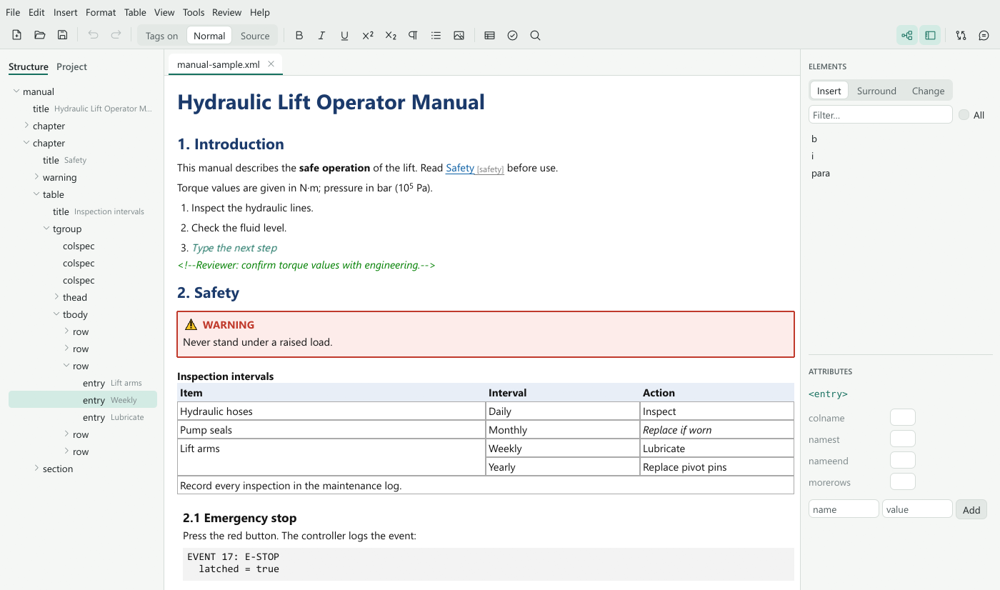
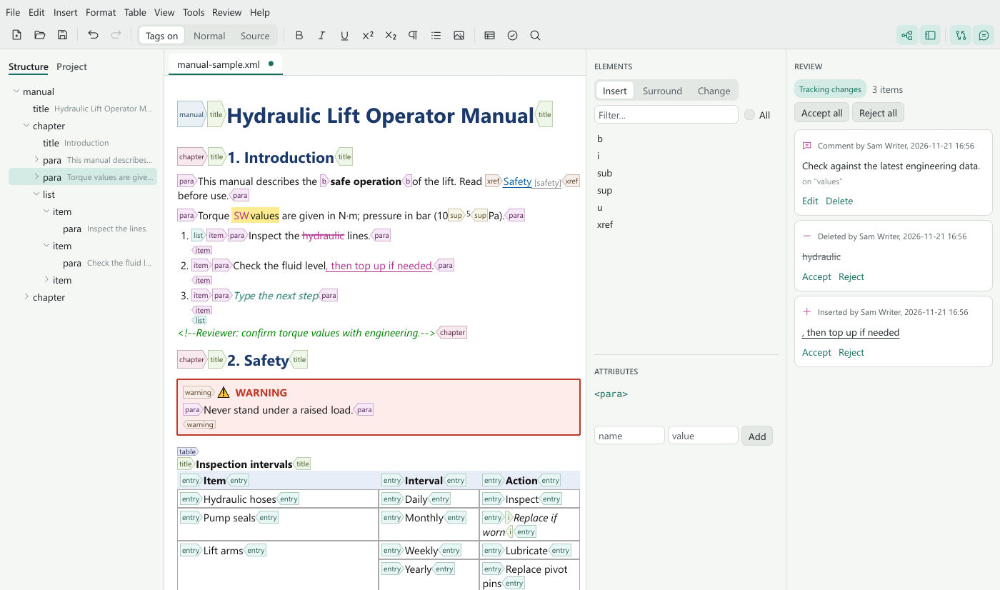
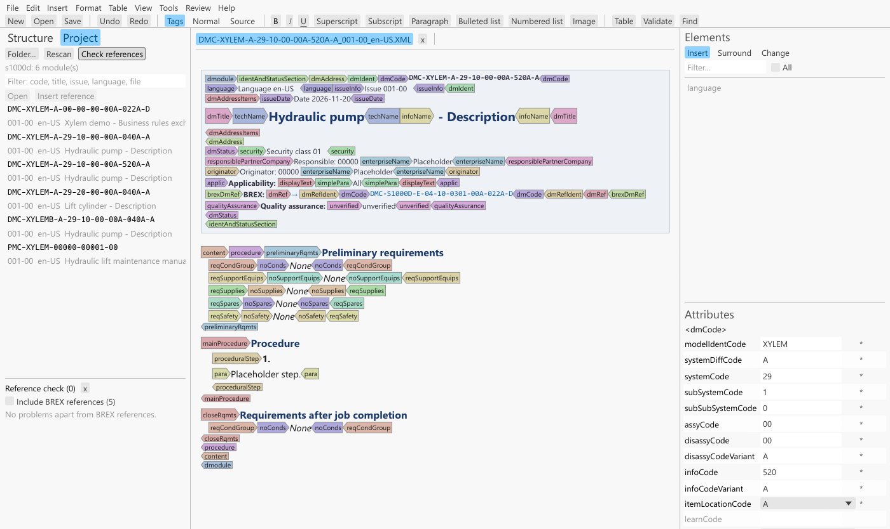

# Xylem

Xylem is a structured XML editor and stylesheet workbench written in Rust.
It was built to replace XMetaL XMAX for writing narrative XML, handles S1000D
(issues 2.0 to 6.0), and has its own XSLT 2.0 / XPath 2.0 engine, so
stylesheets can be written, checked, profiled and previewed without Saxon,
Java or .NET. The same engine can run a publishing system's stylesheets in
place of Saxon through a C library (see [docs/embedding.md](docs/embedding.md)).
Everything is pure Rust. It is built and tested on Windows and Linux; macOS
should work but has not been built yet.



What it does:

- Shows the document styled by CSS, either with tags visible ("tags on") or as
  plain formatted text, plus a source view. The XMetaL flavour of CSS that
  XMAX customizations use (`$PROCINS`, `$COMMENT`, counters, generated
  content) works as-is.
- Uses the XSD or DTD to guide editing: only valid elements are offered, new
  elements come with their required content, and validation runs as you type.
- Saves without reformatting: markup you didn't touch is written back byte for
  byte, including entities, quoting, whitespace and encoding.
- Has CALS and HTML tables, find and replace, spell checking with Hunspell
  dictionaries, a structure tree, an attribute inspector and an issues list.
- Tracks changes and keeps review comments as XMetaL-style processing
  instructions (not yet checked against files written by XMetaL itself); see
  [docs/track-changes.md](docs/track-changes.md).
- Finds and replaces across a folder of files (Edit › Find in files). It
  searches text, and attribute values on request, but never tags or
  comments, and rewrites only the matched text in each file.
- Exports a styled, standalone HTML page that looks like the Normal view
  (File › Export to HTML). File › Print preview opens it in your browser to
  print or save as PDF.
- For S1000D: a wizard for new data modules and publication modules, DMC and
  CSDB file naming, BREX checking, dmRef navigation, a built-in stylesheet, a
  project view that lists a CSDB folder and checks the references between its
  modules, and applicability filtering; see [docs/s1000d.md](docs/s1000d.md).
- Converts XMAX customizations (`.ctm` folders and `.xac` archives) into Xylem
  doctype packages with `xylem-import`; see
  [docs/doctype-packages.md](docs/doctype-packages.md).
- Stays quick on long documents (incremental layout, collapsible elements) and
  keeps your work safe (autosave and crash recovery).

For stylesheet authors (see [docs/stylesheet-check.md](docs/stylesheet-check.md)):

- **Run stylesheet** (Ctrl+Shift+R) runs a stylesheet on a document, unsaved
  edits included, and opens the result; **Publication preview**
  (Ctrl+Shift+F5) runs the team's publishing stylesheets, and an FO-to-HTML
  step, on the document being edited and shows it in the browser.
- **Stylesheet references** (F12) lists where a template, function, key,
  mode or variable is defined and used, across every stylesheet that
  includes or imports the file.
- **Check stylesheet output** runs a stylesheet on a suite of real inputs
  and compares the result with saved output, the last committed version or
  another stylesheet, ignoring differences that are not real (generated
  IDs); **Time templates** profiles it; **Analyze** finds slow patterns and
  applies fixes that are proven not to change the output. Suites can be
  made from a folder of saved publications, and results written as an HTML
  report.
- `xylem-xslt-check differential` runs every stylesheet in a folder through
  two engines (for example the built-in one and Saxon) on every input and
  reports every disagreement: the evidence for switching engines.

Schemas can be chosen by root element or mapped from server URLs to local
copies, for one user or a whole team ([docs/team-setup.md](docs/team-setup.md)).

## Screenshots

Tracked changes and a review comment, with tags shown:



An S1000D data module next to the Project tab, which lists the modules in a
folder and checks the references between them:



## Build and run

You need a Rust stable toolchain (1.88 or later).

```
cargo run --release -p xylem-app -- samples/manual-sample.xml
```

To make the sample doctype package available, add its folder to the package path (or use File › Preferences › Add folder):

```
XYLEM_PACKAGES=samples/doctypes cargo run --release -p xylem-app -- samples/manual-sample.xml
```

The binary is `target/release/xylem` (`xylem.exe` on Windows). On Windows it
has no runtime dependencies.

On Linux (tested on Ubuntu 24.04 under WSL), building needs the usual GUI
development packages and running needs a couple of shared libraries:

```
sudo apt install build-essential pkg-config libxkbcommon-dev libwayland-dev \
    libxcb-render0-dev libxcb-shape0-dev libxcb-xfixes0-dev libgl1-mesa-dev \
    libfontconfig-dev libgtk-3-dev          # to build
sudo apt install libxkbcommon-x11-0 libgl1  # to run
```

Xylem draws with OpenGL. Where no GPU driver is available (for example a
virtual machine), run it on X11 with software rendering:
`env -u WAYLAND_DISPLAY LIBGL_ALWAYS_SOFTWARE=1 xylem`.

## Importing XMAX customizations

```
cargo run --release -p xylem-customize --bin xylem-import -- <customization-folder-or.xac> <out-dir>
cargo run --release -p xylem-customize --bin xylem-import -- --all <root> <out-root>
```

Put the output folders in a package folder; the default is `%APPDATA%\Xylem\doctypes` on Windows. Documents are matched to packages by root element, schema location, DOCTYPE public ID or file name. You can also import from inside the editor with File › Import XMAX customization.

## Sharing settings with a team

A team can keep its doctype packages, schemas, BREX and dictionaries in one
shared folder and point every installation at it with a small
`xylem-team.toml`. Xylem reads it from `XYLEM_TEAM_CONFIG`, from next to the
executable, or from the config folder; see [docs/team-setup.md](docs/team-setup.md).

## S1000D schemas

Xylem never downloads schemas. Get them from www.s1000d.org (each issue's
`xml_schema_flat` folder, or `xml_schema` for 2.0–2.2) and either put them in
`<config folder>/schemas/s1000d/S1000D_4-1/...`, which Xylem picks up on its
own, or:

- Schema folder: set *File › Preferences › S1000D schema folder* to a folder that contains one sub-folder per issue, for example `S1000D_4-1/…`. `http://www.s1000d.org/S1000D_4-1/...` URLs are then resolved there.
- Catalog: point *Schema catalog* at a `catalog.toml` or an OASIS XML catalog.

## Keyboard

| Keys | Action |
|---|---|
| Enter / Shift+Enter | split element (or apply its FollowedBy rule) / insert line break |
| Ctrl+B / I / U | bold / italic / underline toggle (per package) |
| Ctrl+E | select the current element |
| Tab / Shift+Tab | next / previous table cell |
| F5 / F6 / F8 | Tags On / Normal / Source view |
| F7 | validate |
| Ctrl+F | find and replace |
| Ctrl+Shift+F | find and replace in files |
| Ctrl+click | follow a link (IDREF, href, dmRef) |
| Ctrl+Shift+V | paste as plain text |
| Ctrl+Space | insert an element (or surround the selection) |
| Ctrl+Shift+- / = | collapse / expand the current element |
| Ctrl+Shift+T | track changes on / off |
| Ctrl+Shift+M | new comment |
| Ctrl+Shift+A / R | accept / reject all changes |
| F3 / Shift+F3 | find next / previous |
| F1 | all keyboard shortcuts |

## Workspace layout

| Crate | Purpose |
|---|---|
| `xylem-dom` | Lossless, editable XML tree (arena, byte-exact serialisation, encodings) |
| `xylem-edit` | Editing engine: caret model, structure-aware commands, tables, undo |
| `xylem-style` | CSS engine (XMetaL dialect, cascade, counters, generated content) |
| `xylem-schema` | XSD and DTD grammars, validation, schema-guided editing queries, catalogs |
| `xylem-xpath` | XPath 1.0 |
| `xylem-s1000d` | S1000D detection, codes, references, BREX, templates |
| `xylem-customize` | Doctype packages and the XMAX importer (`xylem-import`) |
| `xylem-xslt-engine` | XSLT 2.0 / XPath 2.0 processor (also runs XSLT 1.0 stylesheets the way .NET's processor does) |
| `xylem-xslt-ffi` | The engine as a C library (`xylem_xslt.dll` / `.so` / `.dylib`) |
| `xylem-xslt-cli` | The engine on the command line (`xylem-xslt transform`, `serve`) |
| `xylem-xslt` | Stylesheet tools: check, profile, analyze, prove, differential, navigation (`xylem-xslt-check`) |
| `xylem-w3c` | Runs the W3C XPath and XSLT test suites against the engine |
| `xylem-app` | The egui/eframe desktop application (`xylem`) |

## Testing

```
cargo test --workspace
XYLEM_SCHEMA_CORPUS=<folder of real XSDs and instances> cargo test -p xylem-schema --release --test corpus -- --ignored --nocapture
XYLEM_XML_CORPUS=<folders or files of real XML> cargo test -p xylem-dom --release --test roundtrip_corpus -- --ignored --nocapture
XYLEM_FUZZ_RUNS=3000 cargo test -p xylem-edit --release random_edits
```

The corpus test checks that every well-formed file saves back byte for byte;
run it on a real content export before relying on Xylem for that content.

The app has a scripted end-to-end harness for UI testing:

```
XYLEM_SCRIPT="caretend Some text;;type Hello;;key Enter;;shot out.png;;save out.xml;;quit" xylem file.xml
```

Steps find their targets by command name, document text or widget label (`cmd SaveAs`, `caret Some text`, `clickui Insert table`), so scripts survive layout changes; `crates/xylem-app/src/script.rs` lists them all. `scripts/e2e-smoke.sh` runs the end-to-end cases and `scripts/ui-screens.sh` screenshots every window in both themes; see [CONTRIBUTING.md](CONTRIBUTING.md).

Scripted runs never open a web browser: Print preview writes its page to `xylem-print` in the temporary folder and reports the path. Set `XYLEM_NO_BROWSER=1` to get the same behaviour outside the harness.

Set `XYLEM_WINDOW_POS=x,y` (and optionally `XYLEM_WINDOW_SIZE=w,h`) to put test windows somewhere out of the way, such as a second monitor; they never take focus. [docs/ui-design.md](docs/ui-design.md) describes the theme and shared UI components.

See [PARITY.md](PARITY.md) for the XMAX feature checklist.

## License

MIT. See [LICENSE](LICENSE).

S1000D schemas are not part of this repository. Point Xylem at your own copy (see "S1000D schemas" above).
